

<picture><source media="(prefers-color-scheme: dark)" srcset="assets/hero-dark.svg"></picture>

<picture><source media="(prefers-color-scheme: dark)" srcset="assets/wave-dark.svg"></picture>

<picture><source media="(prefers-color-scheme: dark)" srcset="assets/social-l-dark.svg"></picture><a href="https://t.me/Imsokrat"><picture><source media="(prefers-color-scheme: dark)" srcset="assets/social-1-dark.svg"></picture></a><a href="https://discord.com/"><picture><source media="(prefers-color-scheme: dark)" srcset="assets/social-2-dark.svg"></picture></a><a href="https://nemuritv.xyz"><picture><source media="(prefers-color-scheme: dark)" srcset="assets/social-3-dark.svg"></picture></a><picture><source media="(prefers-color-scheme: dark)" srcset="assets/social-r-dark.svg"></picture>

<picture><source media="(prefers-color-scheme: dark)" srcset="assets/about-dark.svg"></picture>

<picture><source media="(prefers-color-scheme: dark)" srcset="assets/stack-dark.svg"></picture>

<a href="https://github.com/Pre11yhacker/Sokrat-skill"><picture><source media="(prefers-color-scheme: dark)" srcset="assets/project-sokrat-skill-dark.svg"></picture></a>&nbsp;<a href="https://github.com/Pre11yhacker/KREST"><picture><source media="(prefers-color-scheme: dark)" srcset="assets/project-krest-dark.svg"></picture></a>

<a href="https://github.com/Pre11yhacker/telegramclient"><picture><source media="(prefers-color-scheme: dark)" srcset="assets/project-telegramclient-dark.svg"></picture></a>&nbsp;<a href="https://github.com/Pre11yhacker/Pre11yhacker"><picture><source media="(prefers-color-scheme: dark)" srcset="assets/project-pre11yhacker-dark.svg"></picture></a>

<picture><source media="(prefers-color-scheme: dark)" srcset="assets/stats-dark.svg"></picture>

<picture><source media="(prefers-color-scheme: dark)" srcset="assets/streak-dark.svg"></picture>

<a href="sokratdev.xyz"><picture><source media="(prefers-color-scheme: dark)" srcset="assets/button-1-dark.svg"></picture></a>&nbsp;&nbsp;<a href="https://github.com/Pre11yhacker?tab=repositories"><picture><source media="(prefers-color-scheme: dark)" srcset="assets/button-2-dark.svg"></picture></a>

<a href="https://metawka.github.io/expressive-profile/?from=Pre11yhacker"><picture><source media="(prefers-color-scheme: dark)" srcset="assets/credit-dark.svg"></picture></a>

